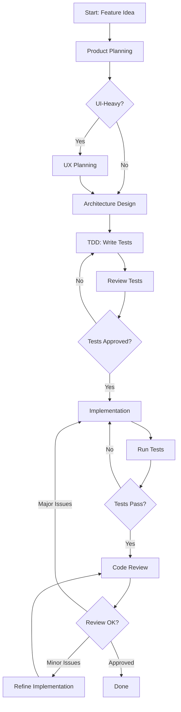
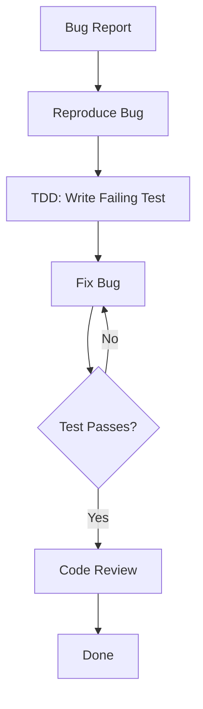
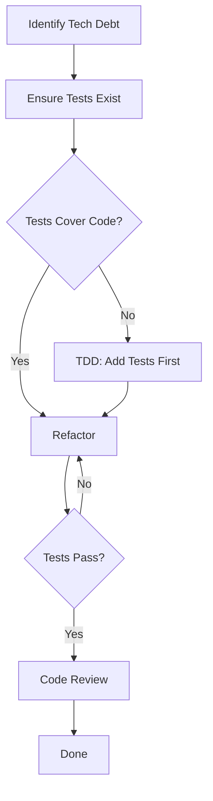

# Development Workflow Skill

## Purpose
Defines complete workflows for developing features using the multi-agent system. Ensures proper sequencing, handoffs, and quality gates between agents.

## Overview

The development process follows a structured flow through multiple phases, each handled by specialized agents. This ensures quality, maintainability, and alignment with product goals.

## Core Workflow: New Feature Development



## Phase 1: Product Planning

### When to Use
- Starting a new feature
- Exploring a new product idea
- Refining unclear requirements

### Agent: Product Strategy

### Steps
1. **Ideation Session**
   ```
   User → Product Agent: "I want to build [idea]"
   Product Agent:
   - Asks clarifying questions
   - Explores use cases
   - Identifies target users
   - Brainstorms features
   ```

2. **Define Goals**
   - What does success look like?
   - Key metrics
   - Constraints (time, budget, technical)

   Output: `_product/goals/[project]-goals.md`

3. **Create Personas**
   - 2-4 user personas
   - Demographics, goals, pain points
   - Technical proficiency

   Output: `_product/personas/[persona-name].md`

4. **Write User Stories**
   - As a [persona], I want [action], so that [benefit]
   - Acceptance criteria
   - Priority and complexity

   Output: `_product/user-stories/[story-id]-[title].md`

5. **Build Roadmap**
   - MVP scope
   - Phase 1, 2, 3...
   - Dependencies between stories

   Output: `_product/roadmaps/[project]-roadmap.md`

### Quality Gate
- [ ] User stories have clear acceptance criteria
- [ ] Stories are prioritized
- [ ] MVP is defined
- [ ] Documents are in `review` status
- [ ] Lars approves product plan

### Typical Interaction
```
User: "I want to build a feature management system"

Product Agent:
- Creates project structure in Obsidian
- Explores target users, use cases
- Creates 2 personas (Product Manager, Developer)
- Writes 5 user stories for MVP
- Creates roadmap with 3 phases

Output: All docs in _product/ folder, status: review

User reviews and approves → Status changes to approved
```

---

## Phase 2: UX Planning (Optional, for UI-Heavy Features)

### When to Use
- Feature has significant UI components
- User interaction is complex
- Multiple screens/views involved
- Accessibility is critical

### When to Skip
- Backend-only features (APIs, services)
- Simple CRUD with standard patterns
- CLI tools

### Agent: UX Planner

### Steps
1. **Review Product Docs**
   - Read approved user stories
   - Understand personas
   - Check product goals

2. **Map User Journeys**
   - Entry points
   - Step-by-step flows
   - Decision points
   - Success criteria

   Output: `_ux/user-journeys/[journey-name].md`

3. **Define Interaction Patterns**
   - How users interact (forms, gestures, etc.)
   - Feedback mechanisms
   - Navigation patterns

   Output: `_ux/interaction-patterns/[pattern-name].md`

4. **Plan Screens/Views**
   - Information architecture
   - Component hierarchy
   - States (loading, error, empty, success)
   - Responsive behavior

   Output: `_ux/wireframes/[screen-name].md`

### Quality Gate
- [ ] All user stories have UX coverage
- [ ] User journeys are complete
- [ ] All UI states documented
- [ ] Accessibility considered
- [ ] Documents in `review` status
- [ ] Lars approves UX plan

### Typical Interaction
```
User: "Design UX for [[US-001-create-feature]]"

UX Agent:
- Reads user story and personas
- Creates user journey for feature creation flow
- Designs form interaction pattern
- Plans screen layout with states
- Considers mobile/desktop responsive behavior

Output: All docs in _ux/ folder, linked to user story

User reviews and approves
```

---

## Phase 3: Architecture Design

### When to Use
- Every feature (mandatory)
- New project setup
- Significant refactoring
- Technology decisions

### Agent: Architecture

### Steps
1. **Review Context**
   - Read project config
   - Review product requirements
   - Check existing ADRs

2. **High-Level Design** (for new projects)
   - System components
   - Communication patterns
   - Data flow
   - External dependencies

   Output: `_architecture/system-design/[project]-architecture.md`

3. **Technology Decisions** (when needed)
   - Evaluate alternatives
   - Document trade-offs
   - Consider team skills, maintenance

   Output: `_architecture/tech-stack.md`

4. **Create ADRs** (for significant decisions)
   - Context: What problem?
   - Decision: What did we choose?
   - Consequences: What are the impacts?
   - Alternatives: What else did we consider?

   Output: `_architecture/decisions/[NNNN]-[title].md`
   Also copy to: `[git-repo]/docs/architecture/decisions/`

5. **Create Diagrams** (when helpful)
   - System context
   - Component diagrams
   - Sequence diagrams for complex flows

   Output: `_architecture/diagrams/[name].md`

### Quality Gate
- [ ] Component boundaries are clear
- [ ] Significant decisions have ADRs
- [ ] Architecture aligns with project patterns
- [ ] ADRs are in `proposed` status
- [ ] Lars approves architecture

### Typical Interaction
```
User: "Design architecture for [[US-001-create-feature]]"

Architecture Agent:
- Reads project config (Clean Architecture + DDD)
- Reads user story and acceptance criteria
- Creates ADR for error handling approach
- Specifies which layers are involved
- Defines interfaces and contracts

Output: ADR in _architecture/decisions/, status: proposed

User approves → Status changes to accepted
```

---

## Phase 4: Test-Driven Development

### When to Use
- Always (before implementation)
- Every user story
- Every bug fix (add regression test)

### Agent: TDD Test

### Steps
1. **Read Requirements**
   - User story: `_product/user-stories/[story-id].md`
   - Architecture: Relevant ADRs
   - UX specs: If applicable
   - Project config: Test frameworks to use

2. **Plan Tests**
   - Unit tests (business logic)
   - Integration tests (component interactions)
   - Edge cases
   - Error scenarios

   Output: `_tests/test-plans/[feature]-test-plan.md`

3. **Write Tests**
   - Follow test frameworks from project config
   - Use proper naming conventions
   - Cover all acceptance criteria
   - Include edge cases and errors

   Output: Test files in project repository

   Example for .NET:
   - `tests/UnitTests/[Namespace]/[Feature]Tests.cs`
   - `tests/IntegrationTests/[Feature]IntegrationTests.cs`

4. **Document Tests**
   - Test structure
   - Running instructions
   - Coverage expectations

   Output: `_tests/test-documentation/[feature]-test-docs.md`

5. **Verify Red Phase**
   - Run tests
   - Confirm they fail (no implementation yet)
   - Failures should be meaningful

### Quality Gate
- [ ] All acceptance criteria have tests
- [ ] Edge cases covered
- [ ] Error scenarios tested
- [ ] Tests compile but fail (Red phase)
- [ ] Test documentation complete
- [ ] Lars approves tests

### Typical Interaction
```
User: "Write tests for [[US-001-create-feature]]"

TDD Test Agent:
- Reads user story acceptance criteria
- Reads architecture ADRs
- Checks project config (xUnit + Shouldly)
- Creates test plan
- Writes unit tests for validation logic
- Writes integration tests for API endpoint
- Documents test structure

Output:
- Test plan in _tests/test-plans/
- Test files in project repo tests/
- Test docs in _tests/test-documentation/
- Runs tests → All fail ✓ (Red phase)

User reviews tests:
- Checks they cover requirements
- Approves tests
```

---

## Phase 5: Implementation

### When to Use
- After tests are approved
- Tests are failing (Red phase)

### Agents: Implementation OR Frontend Implementation

### Decision: Which Agent?
- **Implementation Agent**: Backend code, APIs, business logic, data access
- **Frontend Implementation Agent**: UI components, user interactions, client-side logic

For full-stack features:
1. Backend first (Implementation Agent)
2. Then frontend (Frontend Implementation Agent)

### Steps

#### For Backend (Implementation Agent)
1. **Review Context**
   - Read project config
   - Study architecture docs and ADRs
   - Read the tests
   - Understand user story

2. **Verify Tests Fail**
   ```bash
   dotnet test  # Should fail
   ```

3. **Implement to Make Tests Pass**
   - Follow Clean Architecture layers:
     - Domain: Entities, value objects, business rules
     - Application: Use cases, commands, queries
     - Infrastructure: Database, external APIs
     - Presentation: Controllers, DTOs
   - Follow SOLID principles
   - Use proper error handling (Result pattern)
   - Keep it simple (no premature optimization)

4. **Run Tests Continuously**
   ```bash
   dotnet watch test  # Auto-run on file changes
   ```

5. **Verify Tests Pass**
   ```bash
   dotnet test  # Should pass ✓ (Green phase)
   ```

#### For Frontend (Frontend Implementation Agent)
1. **Review Context**
   - Read UX specifications
   - Read user story
   - Check existing tests (if any)

2. **Implement Components**
   - Follow UX wireframes and interaction patterns
   - Implement all UI states (loading, error, empty, success)
   - Ensure accessibility (WCAG 2.1 AA)
   - Make responsive (mobile, tablet, desktop)
   - Write component tests

3. **Verify**
   ```bash
   npm test          # Component tests pass
   npm run lint      # No linting errors
   npm run type-check # TypeScript checks pass
   ```

### Quality Gate
- [ ] All tests pass (Green phase)
- [ ] Code follows architecture patterns
- [ ] No linting/compilation errors
- [ ] Proper error handling
- [ ] Code is clean and readable
- [ ] Ready for code review

### Typical Interaction
```
User: "Implement [[US-001-create-feature]] to make tests pass"

Implementation Agent:
- Reviews architecture (Clean Architecture + DDD)
- Reads tests to understand expectations
- Implements Domain layer: Feature entity
- Implements Application layer: CreateFeatureCommand + Handler
- Implements Infrastructure layer: FeatureRepository
- Implements Presentation layer: FeaturesController
- Runs tests continuously
- All tests pass ✓

Output: Implementation complete, tests green
```

---

## Phase 6: Code Review

### When to Use
- After implementation is complete
- Tests are passing
- Before merging to main branch

### Agent: Code Review

### Steps
1. **Automated Checks**
   ```bash
   dotnet test              # Tests pass
   dotnet format --verify   # Formatting OK
   dotnet build /p:TreatWarningsAsErrors=true  # No warnings
   ```

2. **Review Dimensions**
   - **Architectural Compliance**
     - Follows Clean Architecture?
     - Adheres to ADRs?
     - Correct dependency flow?

   - **Code Quality**
     - SOLID principles
     - Code smells
     - Naming conventions

   - **Error Handling**
     - Proper exception handling
     - Meaningful error messages
     - Result pattern used

   - **Performance**
     - No N+1 queries
     - Proper async/await
     - No obvious bottlenecks

   - **Security**
     - Input validation
     - No SQL injection
     - No XSS vulnerabilities

   - **Testing**
     - Coverage meets target
     - Edge cases tested
     - No tests modified to pass

3. **Generate Review Report**
   - Critical issues (must fix)
   - Medium priority (should fix)
   - Low priority (nice to have)
   - Positive observations
   - Suggestions for refactoring

   Output: `_reviews/[feature]-review-[date].md`

4. **Prioritize Issues**
   - 🔴 Critical: Security, data corruption, architecture violations
   - 🟡 Medium: Code smells, performance, missing coverage
   - 🟢 Low: Naming, style, minor refactoring

### Quality Gate
- [ ] No critical issues OR critical issues fixed
- [ ] Lars approves the code
- [ ] Refactoring decisions made

### Typical Interaction
```
User: "Review the implementation of [[US-001-create-feature]]"

Code Review Agent:
- Runs automated checks (pass)
- Reviews architectural compliance (good)
- Identifies 1 critical issue: missing null check
- Identifies 2 medium issues: method too long, missing Result pattern
- Identifies 1 low issue: variable naming
- Creates structured review report

Output: Review report in _reviews/

User decides:
- Fix critical issue immediately
- Fix medium issue #1, skip #2 for now
- Skip low priority issue

Implementation Agent fixes critical + selected medium issues
Code Review Agent re-reviews → Approved
```

---

## Phase 7: Refactoring (If Needed)

### When to Use
- Code review identifies issues
- Technical debt needs addressing
- Patterns need improvement

### Agent: Implementation (or Frontend Implementation)

### Steps
1. **Review feedback from Code Review Agent**
2. **Prioritize changes** (what to fix now vs later)
3. **Refactor** while keeping tests green
4. **Verify tests still pass**
5. **Request re-review** if significant changes

### Quality Gate
- [ ] All tests still pass
- [ ] Issues addressed
- [ ] Code Review Agent approves

---

## Supporting Workflows

### Workflow: Bug Fix



1. **Reproduce** the bug
2. **TDD Agent**: Write test that reproduces bug (fails)
3. **Implementation Agent**: Fix bug to make test pass
4. **Code Review Agent**: Review fix
5. Done

### Workflow: Refactoring



1. **Identify** what needs refactoring
2. **Ensure tests exist** (add if missing)
3. **Refactor** while keeping tests green
4. **Code Review** the changes
5. Done

### Workflow: New Project Setup

1. **Product Agent**:
   - Initial exploration and goals
   - Create project folder in Obsidian
   - Create `project-config.md`

2. **Architecture Agent**:
   - Design high-level architecture
   - Choose technology stack
   - Create initial ADRs
   - Document in `_architecture/`

3. **Implementation Agent** (or you):
   - Initialize git repository
   - Set up project structure
   - Configure build tools
   - Create README

4. **Ready for feature development** → Follow main workflow

---

## Agent Orchestration

### Who Decides Next Steps?

#### Option 1: Lars Drives (Recommended for now)
You explicitly call each agent:
```
You: "Let's plan this feature"
→ Product Agent works

You: "Now design the UX"
→ UX Agent works

You: "Design the architecture"
→ Architecture Agent works

You: "Write tests"
→ TDD Agent works

You: "Implement"
→ Implementation Agent works

You: "Review"
→ Code Review Agent works
```

**Pros**: Full control, clear intent
**Cons**: More manual, need to know workflow

#### Option 2: Main Claude Orchestrates (Future)
Main Claude agent reads this workflow and orchestrates:
```
You: "Implement the feature creation functionality"

Claude:
1. Reads workflow skill
2. Checks what phase we're in
3. Determines Product Agent should run first
4. Calls Product Agent
5. After approval, calls next agent
6. Continues through workflow
```

**Pros**: More automated, follows workflow
**Cons**: Less control, need trust in automation

### Handoff Protocol

When one agent finishes:
```markdown
**[Agent Name] Complete**

Created:
- [List of files/documents]

Status: [draft/review/approved]

Next Steps:
- Lars reviews and approves
- Then [Next Agent] can work on [Next Phase]

Dependencies for Next Agent:
- Must read: [[doc1]], [[doc2]]
- Requires: [Any prerequisites]
```

---

## Quality Gates Summary

Each phase has a quality gate before proceeding:

| Phase | Quality Gate | Approver |
|-------|-------------|----------|
| Product Planning | User stories with clear acceptance criteria, prioritization done | Lars |
| UX Planning | All user stories have UX coverage, states documented | Lars |
| Architecture | Significant decisions have ADRs, patterns are clear | Lars |
| TDD | Tests cover acceptance criteria, tests fail (Red) | Lars |
| Implementation | Tests pass (Green), code compiles | Tests |
| Code Review | No critical issues, approved by reviewer | Lars |
| Done | All gates passed, ready to merge | Lars |

---

## Common Scenarios

### Scenario 1: Simple Backend Feature (No UI)
```
1. Product Agent → User story
2. Architecture Agent → Review/create ADRs (if needed)
3. TDD Agent → Write tests
4. Implementation Agent → Make tests pass
5. Code Review Agent → Review
6. Done
```

### Scenario 2: Full-Stack Feature (UI + Backend)
```
1. Product Agent → User story
2. UX Agent → Design interactions
3. Architecture Agent → Design system
4. TDD Agent → Write backend tests
5. Implementation Agent → Backend implementation
6. Code Review Agent → Review backend
7. Frontend Implementation Agent → UI implementation (may have own tests)
8. Code Review Agent → Review frontend
9. Done
```

### Scenario 3: Quick Bug Fix
```
1. TDD Agent → Write regression test (fails)
2. Implementation Agent → Fix bug (test passes)
3. Code Review Agent → Quick review
4. Done
```

### Scenario 4: Large Refactoring
```
1. Architecture Agent → Document refactoring approach (ADR)
2. TDD Agent → Ensure test coverage exists
3. Implementation Agent → Refactor incrementally
4. Code Review Agent → Review changes
5. Repeat steps 3-4 until complete
6. Done
```

---

## Token Optimization Integration

### When to Run Token Optimization
- **NOT during active development**
- **After completing a major feature**
- **Monthly review**
- **When costs seem high**

### Process
```
User: "Run token optimization for last month"

Token Optimization Agent:
- Analyzes conversation logs
- Identifies inefficient patterns
- Generates optimization report
- Suggests prompt improvements
- Calculates cost/environmental impact

Output: Report in _optimization/

User reviews and implements suggestions
```

---

## Tips for Effective Workflow

### DO ✅
- Follow the workflow sequence
- Get approvals at quality gates
- Link documents with wikilinks
- Keep documents in Obsidian updated
- Run token optimization periodically
- Reference previous work instead of redoing

### DON'T ❌
- Skip phases (especially TDD)
- Implement before tests are approved
- Mix multiple features in one workflow
- Approve documents you haven't reviewed
- Optimize tokens during active development
- Re-read documents unnecessarily

---

## Troubleshooting

### "Agent seems confused about what to do"
→ Check if previous phase is complete and approved
→ Ensure required documents exist
→ Provide more context in your request

### "Tests pass but code review finds issues"
→ Tests may not cover everything
→ Update tests to catch the issue
→ Add to test plan for future

### "Workflow feels too rigid"
→ It's a guide, not a rule
→ Skip/adapt phases as needed
→ Simpler features can use simpler workflows

### "Too much back-and-forth"
→ See token optimization agent
→ Provide more context upfront
→ Reference existing documents

---

## Examples

### Example: Complete Feature Flow

**User Request**: "I want to add user authentication to my app"

**Phase 1: Product Planning**
```
User: "I want to add authentication. Start with product planning"

Product Agent:
→ Creates project structure
→ Asks about auth method (OAuth, JWT, etc.)
→ Creates user stories:
  - US-001: User can register
  - US-002: User can login
  - US-003: User can logout
  - US-004: Protected routes
→ Creates persona: "End User"
→ Defines goals and acceptance criteria
→ Status: review

User: "Looks good, approve all"
→ Status: approved
```

**Phase 2: UX Planning** (if UI needed)
```
User: "Design UX for authentication"

UX Agent:
→ Reads user stories
→ Creates user journeys for registration, login, logout
→ Designs login form, registration form
→ Specifies error states, loading states
→ Plans responsive layout
→ Status: review

User: "Approved"
→ Status: approved
```

**Phase 3: Architecture**
```
User: "Design architecture for authentication"

Architecture Agent:
→ Reads user stories
→ Creates ADR-0020: "Use JWT for authentication"
→ Creates ADR-0021: "Hash passwords with bcrypt"
→ Defines interfaces: IAuthService, IUserRepository
→ Documents security considerations
→ Status: proposed

User: "Approved"
→ Status: accepted
```

**Phase 4: TDD**
```
User: "Write tests for [[US-001-user-can-register]]"

TDD Agent:
→ Reads user story and ADRs
→ Creates test plan
→ Writes unit tests for registration logic
→ Writes integration tests for /api/auth/register endpoint
→ Tests compile but fail ✓
→ Status: review

User: "Tests look good"
→ Approved
```

**Phase 5: Implementation**
```
User: "Implement to make tests pass"

Implementation Agent:
→ Implements User entity (Domain layer)
→ Implements RegisterCommand + Handler (Application layer)
→ Implements UserRepository (Infrastructure layer)
→ Implements AuthController (Presentation layer)
→ Tests pass ✓

Output: Implementation complete
```

**Phase 6: Code Review**
```
User: "Review the authentication implementation"

Code Review Agent:
→ Runs automated checks (pass)
→ Reviews architecture compliance (good)
→ Identifies issue: Password not validated for strength
→ Suggests: Add password complexity requirements
→ Creates review report

User: "Fix the password validation"

Implementation Agent:
→ Adds password validation
→ Tests still pass ✓

User: "Re-review"

Code Review Agent:
→ Approved ✓
```

**Done!** Feature complete and reviewed.

---

## Version History
- 2025-01-26: Initial creation with comprehensive workflow documentation
